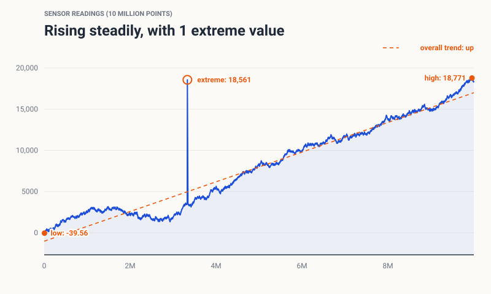

# graphscribe

A line chart that explains itself.

[](https://pypi.org/project/graphscribe/)
[](https://pypi.org/project/graphscribe/)
[](https://github.com/mishraxharshit/graphscribe/actions/workflows/ci.yml)
[](LICENSE)


graphscribe draws a line chart from a list of numbers and describes what the data shows: a
one-line headline, the overall trend, extreme values, and the highest and lowest points. The
findings are written in plain English and marked directly on the chart. Charts are drawn by
graphscribe's own SVG renderer. The only dependency is NumPy.

The same call works for twelve monthly values and for tens of millions of sensor readings.

## Installation

```bash
pip install graphscribe
```

Python 3.10 or newer is required.

## Quick start

```python
import numpy as np
import graphscribe as gs

months = np.arange("2025-01", "2026-01", dtype="datetime64[M]")
sales = [112, 118, 125, 123, 131, 140, 138, 150, 149, 162, 171, 168]

chart = gs.line(sales, x=months, title="Monthly sales", y_label="sales")
print(chart.explain())
chart.save("sales.svg")
```

Output of `explain()`:

```
WHAT YOU ARE LOOKING AT
  A line chart of 'sales' with 12 points. Your values come in order, so a line shows how they change from one point to the next.

WHAT THE DATA SAYS
  - There is a strong upward trend. The overall line rises from about 111.2 to 170.2. A straight line explains about 97% of the ups and downs (R-squared = 0.97).
  - The highest value is 171 at 2025-11-01. The lowest is 112 at 2025-01-01.
  - No unusual values (outliers) were found.
  - There are 12 points. sales ranges from 112 to 171. The average is 140.6 and the middle value (median) is 139.
```

In Jupyter, evaluating `chart` on its own displays the chart, the explanation and a short lesson on
how to read a line chart.

## Using it like matplotlib

| You want | matplotlib | graphscribe |
|---|---|---|
| Draw and view in a script | `plt.plot(y)` then `plt.show()` | `gs.line(y).show()` |
| View in Jupyter | `plt.plot(y)` | `gs.line(y)` on the last line of a cell |
| Save to a file | `plt.savefig("a.png")` | `gs.line(y).save("a.svg")` |
| Read what it shows | not available | `print(gs.line(y).explain())` |

`show()` opens the chart in your web browser. On a machine without a browser, such as a remote
server, it saves the file and prints its path instead. In Jupyter it displays the chart inline.
A line of code that only creates a chart, such as `gs.line(y)` in a script, draws nothing until
you call `show()`, `save()` or `explain()`.

## Usage

```python
chart = gs.line(y, x=None, *, title="", x_label="", y_label="")
```

| Method | Returns |
|---|---|
| `chart.explain()` | The findings as plain-English text |
| `chart.headline()` | A one-line summary, for example `Rising steadily, with 1 extreme value` |
| `chart.teach()` | A short guide to reading a line chart, with a glossary |
| `chart.svg(annotate=True)` | The chart as an SVG string. `annotate=False` draws the plain line only |
| `chart.save(path)` | Writes `.svg` (chart) or `.html` (chart, explanation and guide) |
| `chart.show()` | Opens the chart and explanation in a browser |

**Input.** `y` can be a list, a NumPy array or a pandas Series. If `y` is a Series, its index is used
as `x` when it holds numbers or dates. `x` can be numbers or `datetime64` values. Missing values
(NaN) are skipped and reported in the explanation. Unsorted `x` values are sorted.

## Analysis

| Finding | Method |
|---|---|
| Trend | Least-squares line. Reported as strong, moderate or weak from R-squared, with start and end values |
| Extreme values | Points more than three interquartile ranges from the trend line. Marked on the chart |
| Unusual values | Points between 1.5 and 3 interquartile ranges from the trend line. Reported, not marked |
| Highest and lowest | Marked on the chart. With 12 or fewer points every value is labelled instead |
| Summary | Count, range, mean and median |

All statistics are computed from every point, not from the drawn subset.

## Large data

A screen is roughly a thousand pixels wide, so drawing every point of a large series adds nothing.
For each horizontal pixel column, graphscribe keeps the lowest and highest value and draws those.
A single spike therefore remains visible at any size. The SVG stays at about 40 KB.

`benchmarks/bench_line.py` measures this. Each run contains one planted spike, and the last column
shows whether it was found. Times are in seconds for the whole job (load, explain, draw) on a
small cloud machine with 4 GB of RAM.

| Points | Load | Explain | Draw | Total | Peak memory | Spike found |
|---:|---:|---:|---:|---:|---:|:---:|
| 1,000 | 0.001 | 0.010 | 0.001 | 0.012 | 38 MB | yes |
| 10,000 | 0.000 | 0.001 | 0.001 | 0.002 | 39 MB | yes |
| 100,000 | 0.000 | 0.006 | 0.001 | 0.008 | 43 MB | yes |
| 1,000,000 | 0.005 | 0.053 | 0.003 | 0.062 | 77 MB | yes |
| 10,000,000 | 0.063 | 0.705 | 0.039 | 0.806 | 373 MB | yes |
| 50,000,000 | 0.237 | 2.457 | 0.145 | 2.839 | 1,660 MB | yes |



## Limitations

- One series per chart.
- Missing values are skipped and the line is drawn across the gap. A visible gap is planned.
- Output is SVG or HTML. There is no PNG export and no interactivity (zoom, hover).
- Memory use is about 33 bytes per point, because the full series is held in memory. Around
  100 million points need roughly 3.5 GB.
- Explanations are in English only.
- The analysis is intentionally basic. It covers trend, extreme values and range. Seasonality and
  change points are not detected yet.

## Roadmap

1. Multiple series, with a comparison of which one changed most.
2. Gaps for missing data, and detection of repeating patterns (daily, weekly, yearly).
3. Chunked reading, so memory stays flat regardless of data size.
4. PNG export.
5. Zoom that redraws the detail of a selected region.

Other chart types will follow once the line chart is complete.

## Contributing

The most direct way to contribute is a new insight rule: one function in one file that reports
something useful about a line chart in plain language. See [CONTRIBUTING.md](CONTRIBUTING.md) for
setup and conventions. Bug reports with a small example of the data are very welcome.

Security issues should be reported privately as described in [SECURITY.md](SECURITY.md).

## License

Apache License 2.0. See [LICENSE](LICENSE).
