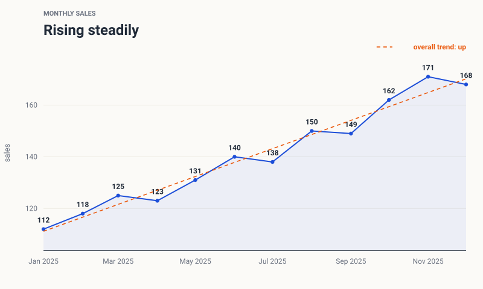
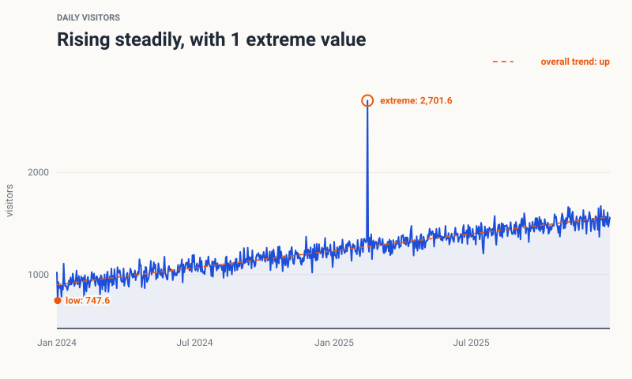

# graphscribe

A line chart that explains itself.

You give it numbers. It draws the chart, writes a headline, points at the important things on the
picture, and teaches you how to read it. It works the same from 5 points to 50 million.



## Why one chart only

I want visualization to be so simple that someone who knows nothing about data can still understand
it. That is a big goal, so I am starting with one graph and going as deep as I can before adding
the next. The line chart is the right first one: it covers a tiny list of monthly sales and a
sensor that logs ten million readings, and a beginner meets it on day one.

The idea underneath: most libraries draw a picture and leave you alone with it. graphscribe also
tells you what you are looking at, the way a good teacher would, and it does that on the chart
itself, not in a paragraph somewhere else.

```python
import graphscribe as gs

chart = gs.line(sales, x=months, title="Monthly sales")

chart                    # in Jupyter: the chart, the explanation and a lesson
print(chart.explain())   # what the data says, in plain English
print(chart.teach())     # how to read a line chart
chart.show()             # opens in your browser
chart.save("sales.svg")  # or "sales.html" (chart + explanation + lesson)
```

## What it does

- **Writes its own headline.** "Rising steadily, with 1 extreme value."
- **Points at what matters.** A ring around a strange value, a dashed trend line, the highest and
  lowest point. No hunting.
- **Adapts to the size of your data.** With 12 points every value is written on the chart. With
  730 you get the shape and the one odd day. With 10 million you get the same clean chart.
- **Understands dates.** Axis labels land on month and year starts, not random days.
- **Never hides a spike.** For every pixel-wide slice of data it keeps the highest and lowest
  value. All the statistics use every single point.
- **Its own renderer.** No matplotlib or any plotting library underneath. The only dependency is
  NumPy. Output is SVG.



## Test it from small to big

`python benchmarks/bench_line.py` runs this on your machine. Every row plants one spike and checks
that graphscribe finds it. These numbers are from a small cloud machine (4 GB RAM):

| Points | Load | Explain | Draw | Total | SVG size | Peak memory | Spike found |
|---:|---:|---:|---:|---:|---:|---:|:---:|
| 1,000 | 0.000 s | 0.010 s | 0.002 s | 0.012 s | 28 KB | 39 MB | yes |
| 10,000 | 0.000 s | 0.001 s | 0.003 s | 0.004 s | 38 KB | 39 MB | yes |
| 100,000 | 0.000 s | 0.006 s | 0.002 s | 0.009 s | 38 KB | 43 MB | yes |
| 1,000,000 | 0.004 s | 0.053 s | 0.003 s | 0.060 s | 38 KB | 79 MB | yes |
| 10,000,000 | 0.077 s | 0.783 s | 0.029 s | 0.889 s | 39 KB | 375 MB | yes |
| 50,000,000 | 0.268 s | 2.587 s | 0.150 s | 3.005 s | 39 KB | 1,660 MB | yes |


## Honest limits (v0.0.1)

- **Memory is the real limit.** It uses about 33 bytes per point, so 100 million points needs
  about 3.5 GB. Reading data in chunks instead of all at once is the first thing to fix.
- **One series per chart.** No multiple lines yet.
- **Missing values are skipped.** The line joins across them. It should show a gap instead.
- **SVG and HTML only.** No PNG yet.
- **Not interactive.** No zoom or hover yet.
- **Explanations are basic.** Trend, extreme values, highest and lowest. A good statistician or
  teacher could make this much better, and that is exactly what I am looking for.

## Where this goes next

Going deeper on the line chart before any new chart type:

1. Multiple lines, with automatic "which one changed most" explanation.
2. Gaps for missing data, and detecting repeating patterns (daily, weekly, yearly).
3. Reading data in chunks, so memory stays small for any size.
4. PNG export from a pure-NumPy encoder.
5. Zoom: re-draw the detail of any region you select.

## Install

Not on PyPI yet. For now:

```bash
pip install git+https://github.com/YOUR_USERNAME/graphscribe
```

## Help build it

The easiest first contribution is one new insight rule: one small function in one file that says
something useful about a line chart in plain English. Read [CONTRIBUTING.md](CONTRIBUTING.md).

## License

Apache License 2.0. See [LICENSE](LICENSE).
